# Sonora

Aplicación web para escuchar música hecha siguiendo el sistema de diseño **Sonora**. La reproducción es simulada (sin audio real).

**Autora:** Rosa De Jesus Collazo Mendoza

## 🔗 Ver el proyecto en vivo

### 👉 [rjcollazo2005.github.io/sonora/fase1-html](https://rjcollazo2005.github.io/sonora/fase1-html/)

Funciona desde cualquier dispositivo (computadora, tableta o celular) sin instalar nada: solo abre el enlace en el navegador. Puedes navegar entre **Inicio**, **Playlist**, **Reproductor**, **Buscar** y **Tu biblioteca**, reproducir canciones, marcar "me gusta" y cambiar a **tema claro**. La canción sigue sonando aunque cambies de pantalla.

## 📸 Capturas

### Escritorio, tema oscuro

| Inicio | Playlist | Reproductor |
|---|---|---|
| 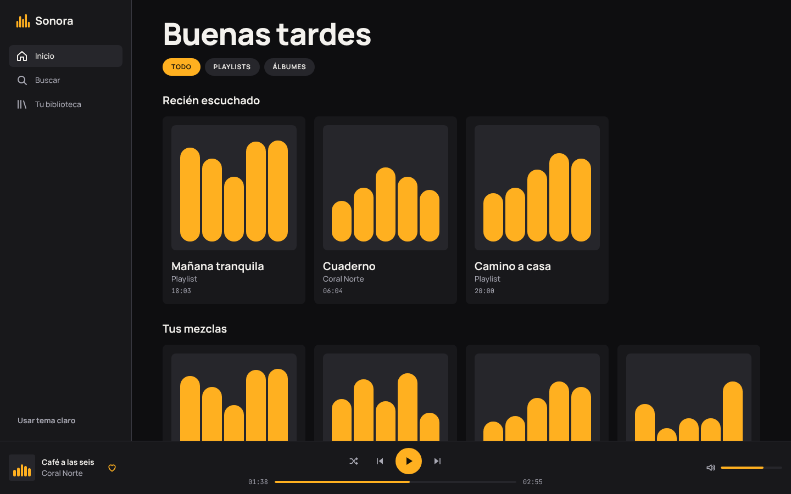 | 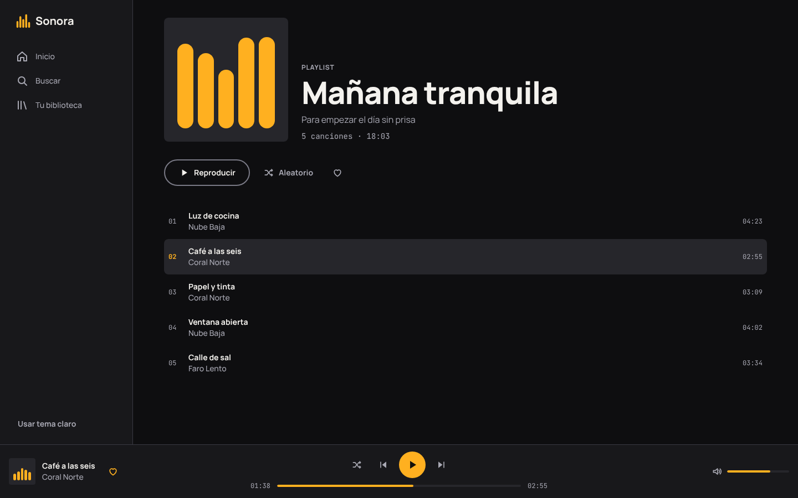 | 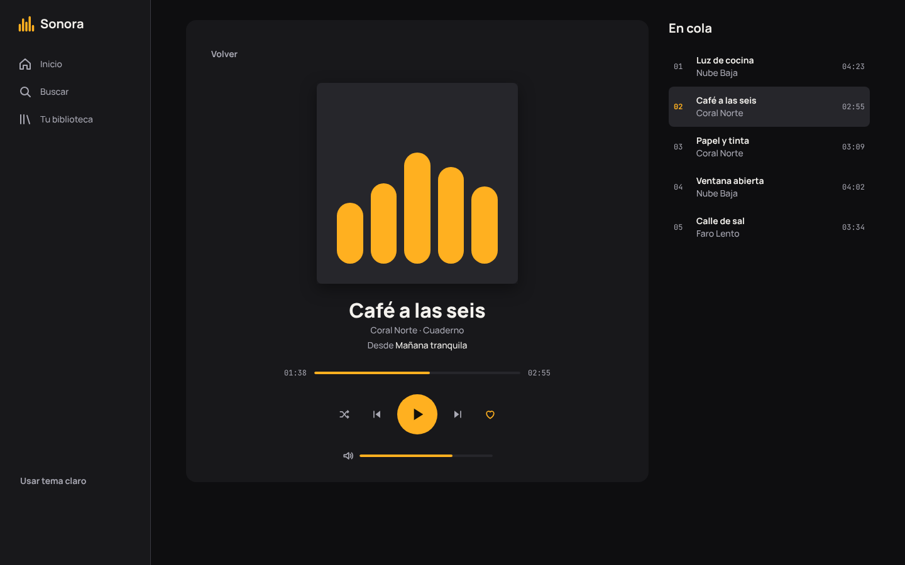 |

### Escritorio, tema claro

| Inicio | Playlist | Reproductor |
|---|---|---|
| 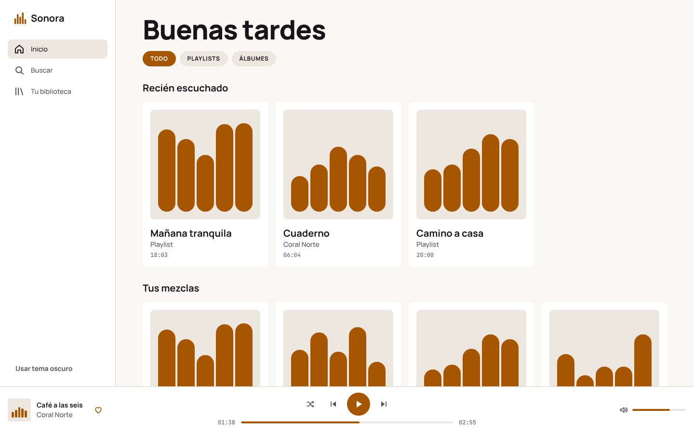 | 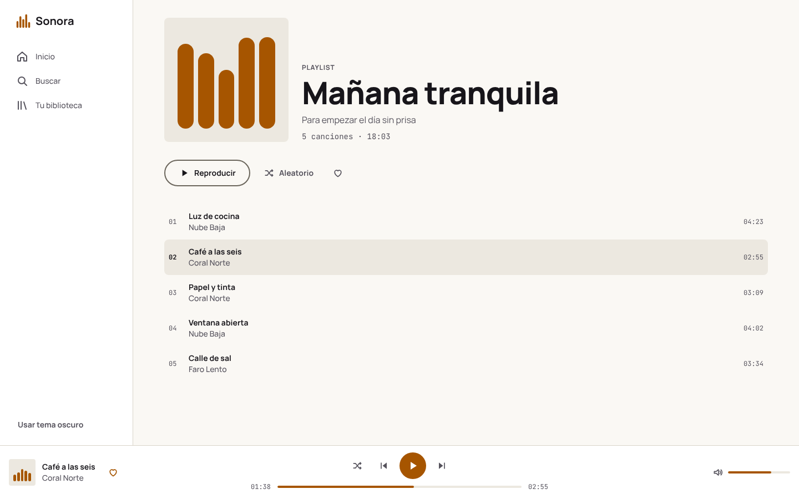 | 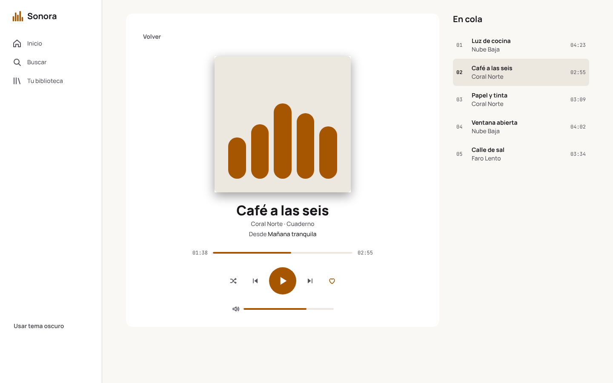 |

### Celular (390 px)

| Inicio | Playlist | Reproductor | Buscar | Tu biblioteca |
|---|---|---|---|---|
| 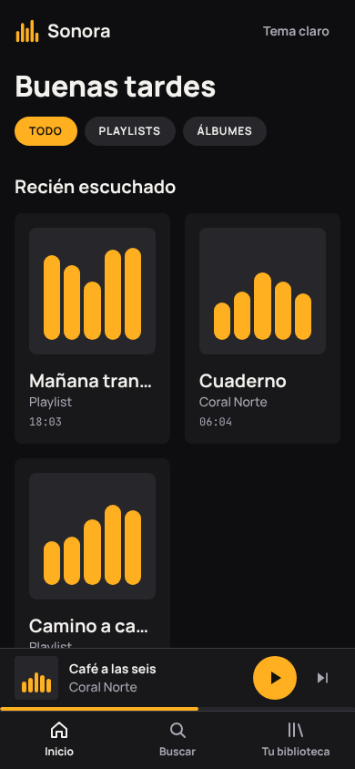 | 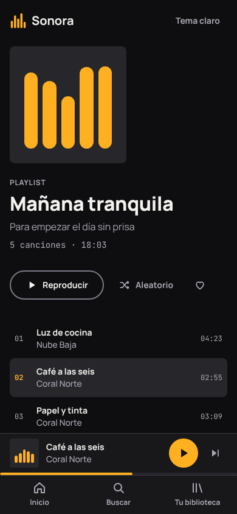 | 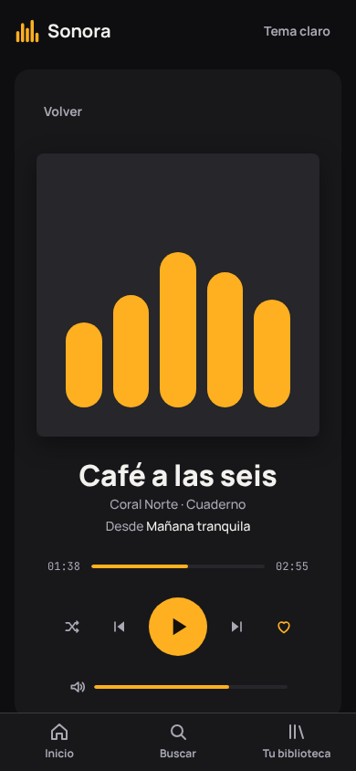 | 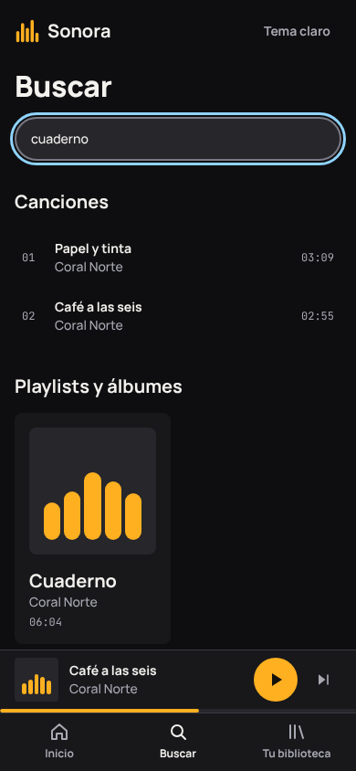 | 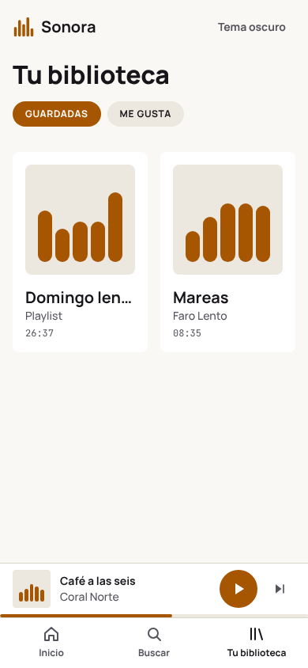 |

Todas las capturas (oscuro y claro, escritorio y celular) están en [fase1-html/capturas](fase1-html/capturas) y [fase2-laravel/capturas](fase2-laravel/capturas).

## 📁 Contenido

| Carpeta | Qué es |
|---|---|
| [fase1-html](fase1-html) | **Fase 1 (obligatoria):** HTML + Tailwind CSS v4. Pantallas Inicio, Playlist y Reproductor, más Buscar, Tu biblioteca, tema claro y versión móvil. |
| [fase2-laravel](fase2-laravel) | **Fase 2 (opcional):** las mismas pantallas en Laravel 13 con componentes Blade, canciones desde la base de datos y rutas reales. |
| [DECISIONES.md](DECISIONES.md) | Qué componentes reutilizamos y qué cambiaríamos. |

## ▶️ Cómo ejecutarlo

### Fase 1

- **En línea:** abre el [enlace en vivo](https://rjcollazo2005.github.io/sonora/fase1-html/) desde cualquier dispositivo.
- **En tu computadora:** descarga el repositorio (botón verde **Code → Download ZIP**), descomprímelo y abre <code>fase1-html/index.html</code> con doble clic. No necesita instalar nada ni internet.

### Fase 2 (Laravel)

Requisitos: PHP 8.3 o más reciente, Composer y Node.js 20 o más reciente (o Laravel Herd).

~~~bash
cd fase2-laravel
composer run setup
php artisan serve
~~~

Después abre http://localhost:8000. Más detalles en el [README de la fase 2](fase2-laravel/README.md).

---

Todas las canciones, artistas, álbumes y playlists son inventados. Los iconos y la marca son los del paquete oficial del sistema de diseño Sonora.
